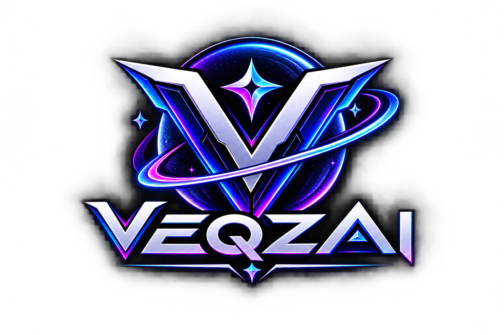

<div align="center">



# VEQZAI

**Play Without Limits.**

VEQZAI is built for people who want to create, compete, explore, and grow beyond traditional limits, turning ideas, skills, and technology into new possibilities.

[**Live site**](https://kuzumato.github.io/VEQZAI/) · [AI Hub](https://kuzumato.github.io/VEQZAI/pages/ai/ai-hub.html) · [Report a bug](../../issues) · [License: GPL-3.0](LICENSE)

</div>

---

## What is VEQZAI?

VEQZAI is a gaming and esports platform: a place to discover games, build a character, track progress, join the community, and compete. It is an early-stage project. This repository holds the public website and a small development backend.

## Status

Being honest about what is real today helps contributors and players.

| Area | Status | Notes |
| --- | --- | --- |
| Landing page | Live | Featured games, features, community highlights |
| Sign up / login | Prototype | Handled in the browser with demo data. Not secure; see [Security notes](#security-notes) |
| Dashboard (Heroes, Armory, Watch, Learn, Arcade, Fandom, Crypto) | Prototype | Mostly static placeholder content |
| Character creator | Prototype | Runs in the browser |
| AI Hub | Live (demo) | Matchmaking, recommendations, moderation, support assistant |
| Auth backend (`backend-auth/`) | Dev scaffold | Not connected to the public site |
| Tournaments, live streaming, anti-cheat, real game library | Planned | Not built yet |

## Features

### Site
- Responsive dark UI with purple and cyan accents
- Featured games, features grid, community stats
- Fandom hub with fan posts and featured characters
- Privacy, Terms and team pages

### Dashboard
- Seven sections: Heroes, Character, Armory, Watch, Learn, Arcade, Fandom
- Coin balance linking to a crypto dashboard preview
- Notifications, favorites and account side panel

### AI Hub
Four tools that run entirely in the browser, with no data sent anywhere.

| Tool | What it does | Code |
| --- | --- | --- |
| Matchmaking | Elo-style skill rating, ping- and role-aware match scoring, search window that widens with queue time | `assets/js/ai/ai-matchmaking.js` |
| Recommendations | Content-based game suggestions that explain why they were picked | `assets/js/ai/ai-recommendations.js` |
| Moderation | Explainable scoring for harassment, threats, scams, personal info and spam | `assets/js/ai/ai-moderation.js` |
| Assistant | FAQ retrieval assistant that says so when it is unsure | `assets/js/ai/ai-assistant.js` |

## Tech stack

- **Frontend:** plain HTML, CSS and JavaScript. No build step.
- **Fonts and icons:** Google Fonts (Rajdhani, Barlow), Font Awesome
- **Backend (dev only):** Node.js, Express, `express-session`, `bcryptjs`
- **Hosting:** GitHub Pages, deployed by `.github/workflows/static.yml` on every push to `main`

## Project structure

```
.
├── index.html                 Landing page
├── signup.html                Sign-up and KYC form (prototype)
├── VEQZAI.html                About page
├── privacy.html, terms.html   Legal pages
├── pages/
│   ├── ai/ai-hub.html         AI Hub
│   ├── auth/login/            Login
│   ├── dashboard/             Dashboard sections and character creator
│   ├── legal/                 Legal pages
│   └── team.html              Team / support
├── assets/
│   ├── css/                   Stylesheets
│   ├── js/                    Page scripts (AI tools are in js/ai/)
│   └── images/                Logos and brand images
├── backend-auth/              Express auth scaffold (development only)
├── backups/                   Old file snapshots
└── .github/workflows/         GitHub Pages deployment
```

## Getting started

### Run the website locally

```bash
git clone https://github.com/Kuzumato/VEQZAI.git
cd VEQZAI
python3 -m http.server 8000
```

Then open <http://localhost:8000>. Any static file server works.

### Run the auth backend (optional)

```bash
cd backend-auth
npm install
npm start
```

The service starts on <http://localhost:3000> (set `PORT` to change it).

| Method | Endpoint | Purpose |
| --- | --- | --- |
| POST | `/api/auth/register` | Create an account (dev) |
| POST | `/api/auth/login` | Log in and start a session |
| POST | `/api/auth/logout` | End the session |
| GET | `/api/auth/me` | Current user |
| POST | `/api/auth/forgot`, `/api/auth/reset` | Password reset flow |
| POST | `/api/characters/save` | Save a character |
| GET | `/api/characters/user/:userId` | List a user's characters |

This backend uses an in-memory session store. See [backend-auth/README.md](backend-auth/README.md) before using anything like it in production.

## Customising the AI Hub

- The player pool and game catalog are sample data. Replace `buildPool()` in `ai-matchmaking.js` and `CATALOG` in `ai-recommendations.js` with your real services.
- Edit the `KB` array in `ai-assistant.js` so the assistant's answers match what is actually live.
- To use a real LLM for the assistant, set this before the scripts load:
  ```html
  <script>window.VEQZAI_AI_CONFIG = { assistantEndpoint: 'https://your-server.example/ask' };</script>
  ```
  The endpoint receives `{ question, context }` and returns `{ answer }`. Keep API keys on that server, never in this repo. If the call fails, the local answer is used.
- `VeqzaiAI.moderation.check(text)` can be reused elsewhere (for example on fan posts). Always enforce moderation on a server too, because browser code can be bypassed.

## Security notes

This is a prototype, so some things are intentionally not production-ready:

- The demo login uses fixed credentials in client-side JavaScript, and the "logged in" state is a browser flag. Do not store anything sensitive behind it.
- The sign-up form collects identity details but there is no server to protect them. Do not enter real personal information.
- Before launch, connect the front end to a real backend with hashed passwords, HTTPS, rate limiting and CSRF protection, and remove the demo credentials.

Found a vulnerability? Please open a private security advisory on GitHub instead of a public issue.

## Roadmap

- [ ] Replace demo login and sign-up with the real auth backend
- [ ] Remove placeholder statistics until they are real
- [ ] Real game library with art and detail pages
- [ ] Tournaments and leaderboards
- [ ] Live streaming and the Watch section
- [ ] Server-side moderation and a reports queue
- [ ] Accessibility pass (keyboard access on game cards, contrast, reduced motion)
- [ ] Repository cleanup (old backups, duplicate pages)

## Contributing

Contributions are welcome.

1. Fork the repository and create a branch: `git checkout -b feature/your-idea`
2. Make your change and test it in a browser, including at phone width
3. Commit with a clear message and open a pull request describing what changed and why

Please keep pages working without a build step, and avoid adding claims to the site about features that are not built yet.

## License

VEQZAI is released under the [GNU General Public License v3.0](LICENSE).

---

<div align="center">

© 2025 VEQZAI · Play Without Limits.

</div># VEQZAI
VEQZAI is built for people who want to create, compete, explore, and grow beyond traditional limits—turning ideas, skills, and technology into new possibilities.
